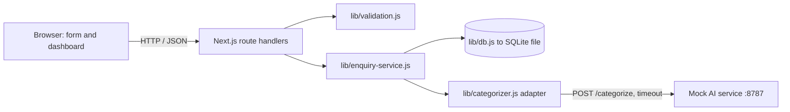

# Customer Enquiry Tracker

A small web app that receives customer enquiries, stores them, categorizes them automatically through a mock AI service, and lets a business track follow-up on a dashboard.

Built for the Intevoris AI Solutions internship assessment.

- **Stack:** Next.js 16 (App Router, JavaScript), Node.js, SQLite (Node's built-in `node:sqlite`)
- **Requires:** Node.js **22.5 or newer** (tested on v22.13.1)

---

## 1. Setup

```bash
# 1. Install dependencies
npm install

# 2. Create your local environment file (no secrets inside)
cp .env.example .env.local        # Windows CMD: copy .env.example .env.local

# 3. Start the mock AI service (Terminal 1, keep it running)
node mock-ai-service.mjs

# 4. Start the app (Terminal 2)
npm run dev
```

Open:

- Customer form: http://localhost:3000
- Business dashboard: http://localhost:3000/dashboard

### Database initialization

There is no manual step. On the first request, `lib/db.js` creates the `data/` folder and the `enquiries` table (`CREATE TABLE IF NOT EXISTS`). To reset all data, stop the app and delete the `data/` folder.

### Environment variables (`.env.example`)

| Variable | Default | Purpose |
|---|---|---|
| `DATABASE_PATH` | `./data/enquiries.db` | SQLite file location |
| `MOCK_AI_URL` | `http://127.0.0.1:8787/categorize` | Mock AI endpoint. Read on the **backend only**, never sent to the browser |
| `AI_TIMEOUT_MS` | `5000` | Timeout for the AI call |

Restart `npm run dev` after changing `.env.local`.

### Mock AI service

> **[FILL IN BEFORE SUBMITTING. Keep ONE of these two and delete the other.]**
>
> **Option A (official file was supplied):** The supplied `mock-ai-service.mjs` is used unchanged. Run it with `node mock-ai-service.mjs` (Node 18+). It listens on `POST http://127.0.0.1:8787/categorize`.
>
> **Option B (substitution):** The supplied mock file was not available to me, so `mock-ai-service.mjs` in this repository is **my own stand-in** written from the assignment description. It has the same endpoint, request fields (`enquiryId`, `message`) and response shape (`{"category": "..."}`), and the same three test behaviours below. Attempts are counted per `enquiryId` in memory, and restarting the service resets them. If you have the official file, replace mine with it; nothing else needs to change.

Test behaviours:

| Message | First attempt | Retry |
|---|---|---|
| `Please send pricing for your automation service.` | `Sales` | n/a |
| `[FAIL_ONCE] I have an invoice question.` | HTTP 503 | `Billing` |
| `[INVALID_ONCE] My login is broken.` | `{"category":"Unexpected"}` | `Support` |

---

## 2. Architecture



Plain-text version:

```
Browser (form + dashboard)
        |  HTTP / JSON
        v
Route handlers (app/api/...)  -- validate --> lib/validation.js
        |
        v
lib/enquiry-service.js  -- save/update --> lib/db.js --> SQLite (data/enquiries.db)
        |
        v
lib/categorizer.js (timeout + category check) --> Mock AI service (127.0.0.1:8787)
```

### Process flow

1. Customer submits the form. The client validates, and the server validates again.
2. The server **saves the enquiry first**: new UUID, `createdAt`, `status = New`, `categorizationState = Pending`, `category = null`.
3. The server calls the mock AI with the **saved enquiry id** and the message.
4. Valid category (`Sales`, `Support`, `Billing`, `Other`): store it and set `categorizationState = Completed`. The business `status` is untouched.
5. Timeout, HTTP error, unreachable service or invalid category: set `categorizationState = Failed`, keep `category = null`. The enquiry is **never lost**.
6. The dashboard lists, filters, shows full messages and updates status. Failed records show **Retry categorization**.
7. Retry reuses the **same id** and updates the existing row. No new record is created.

### Folder structure

```
enquiry-tracker/
├── app/
│   ├── page.js                       Public enquiry form page
│   ├── dashboard/page.js             Dashboard page
│   ├── globals.css                   Shared styles
│   └── api/enquiries/
│       ├── route.js                  POST (create) and GET (list/filter)
│       └── [id]/
│           ├── route.js              PATCH (update status)
│           └── retry/route.js        POST (retry categorization)
├── components/
│   ├── EnquiryForm.js                Client form with validation and feedback
│   └── Dashboard.js                  Client dashboard
├── lib/
│   ├── db.js                         ONLY file with SQL
│   ├── validation.js                 Input rules
│   ├── categorizer.js                Mock AI adapter (timeout, category check, never throws)
│   └── enquiry-service.js            Joins adapter and database for POST and retry
├── mock-ai-service.mjs               Mock AI service
├── .env.example
├── VERIFICATION.md
└── README.md
```

### Data model

Table `enquiries`:

| Column | Notes |
|---|---|
| `id` | UUID, primary key |
| `name`, `email`, `message` | Required text |
| `created_at` | ISO 8601 string, used for newest-first sorting |
| `status` | `New` / `In Progress` / `Resolved` (business workflow) |
| `category` | Nullable. `Sales` / `Support` / `Billing` / `Other` |
| `categorization_state` | `Pending` / `Completed` / `Failed` (AI workflow) |

`CHECK` constraints enforce the allowed values in the database itself. `status` and `categorization_state` are deliberately separate columns.

---

## 3. API reference

All responses are JSON. Errors never include stack traces or internal details.

### POST `/api/enquiries`

Request:

```json
{ "name": "Ali Khan", "email": "ali@example.com", "message": "Please send pricing for your automation service." }
```

Response `201 Created` (also returned when categorization fails, because the enquiry is saved):

```json
{
  "enquiry": {
    "id": "68d3dd9a-9031-400c-a039-3f2fc604e8e2",
    "name": "Ali Khan",
    "email": "ali@example.com",
    "message": "Please send pricing for your automation service.",
    "createdAt": "2026-10-24T06:43:00.922Z",
    "status": "New",
    "category": "Sales",
    "categorizationState": "Completed"
  }
}
```

Response when categorization failed (`201`):

```json
{ "enquiry": { "id": "...", "status": "New", "category": null, "categorizationState": "Failed" } }
```

Response `400 Bad Request`:

```json
{ "error": "Validation failed.", "fields": { "email": "Please enter a valid email address." } }
```

Response `500`: `{ "error": "Could not save your enquiry. Please try again." }`. In this case nothing is reported as success.

### GET `/api/enquiries?status=New`

Newest first. `status` is optional (`New`, `In Progress`, `Resolved`).

```json
{ "enquiries": [ { "id": "...", "name": "...", "status": "New", "category": "Sales", "categorizationState": "Completed" } ] }
```

`400` for an invalid status filter. `500` for server errors.

### PATCH `/api/enquiries/:id`

Request: `{ "status": "In Progress" }`

Response `200`: `{ "enquiry": { ... } }`

`400` for an invalid status or bad JSON. `404` if the id does not exist. `500` for server errors.

### POST `/api/enquiries/:id/retry`

No body. Re-runs categorization for the **existing** record.

Response `200`: `{ "enquiry": { ..., "category": "Billing", "categorizationState": "Completed" } }`. If the retry fails again, the record stays `Failed` with `category: null`.

`404` if the id does not exist. `409` if the enquiry is not in `Failed` state. `500` for server errors.

### curl examples (Windows CMD)

```cmd
curl -i -X POST http://localhost:3000/api/enquiries -H "Content-Type: application/json" -d "{\"name\":\"Ali\",\"email\":\"ali@example.com\",\"message\":\"Please send pricing for your automation service.\"}"
curl http://localhost:3000/api/enquiries
curl "http://localhost:3000/api/enquiries?status=In%20Progress"
curl -i -X PATCH http://localhost:3000/api/enquiries/ID -H "Content-Type: application/json" -d "{\"status\":\"Resolved\"}"
curl -i -X POST http://localhost:3000/api/enquiries/ID/retry
```

---

## 4. Design decisions and tradeoffs

- **Save before categorize.** The record exists in the database before the AI is called, so an AI failure can never lose a customer enquiry.
- **Two status fields.** Business progress (`status`) and AI progress (`categorizationState`) change independently.
- **Category stays `null` until valid.** `Other` is a real category, not an error fallback.
- **Adapter never throws.** `categorizer.js` returns `{ ok, category }` or `{ ok: false, reason }`. Timeout, 503, bad JSON and invalid categories all become one `Failed` path. Reasons are logged on the server and never shown to users.
- **Synchronous categorization with a timeout.** Simple and acceptable for this scope. Tradeoff: the customer waits up to `AI_TIMEOUT_MS` on submit.
- **Retry updates, never inserts.** It reads the existing record by id and calls `UPDATE`, so duplicates are impossible.
- **`node:sqlite` instead of `better-sqlite3`.** `better-sqlite3` is a native module and crashed silently on my Windows machine. Node 22 ships SQLite built in, so nothing needs compiling. Tradeoff: the module is marked experimental (a warning appears in the console). All SQL is isolated in `lib/db.js`, so switching later changes one file.
- **Customer sees success when only AI fails.** The enquiry is saved, and categorization is an internal concern for staff.

### Replacing the mock with a real LLM

Only `lib/categorizer.js` changes: call the LLM API with a prompt that returns one of the four labels, keep the same timeout and the same allowed-category check, and keep the API key in a server-side environment variable. The rest of the app depends on `{ ok, category }` only.

### Adding a priority field

Add a `priority` column (`Low` / `Medium` / `High`) with a `CHECK` constraint, accept it in validation, add it to the PATCH route, and show a selector on the dashboard. A real LLM could also suggest a priority in the same categorization call, with the same valid-value check.

---

## 5. Limitations

- No authentication. The dashboard is public in this local demo, as allowed by the assignment.
- No rate limiting or spam protection on the public form.
- No pagination on the dashboard.
- Categorization is synchronous, with no background queue.
- Automated tests were not written within the time limit. See `VERIFICATION.md` for the manual checklist.
- The `node:sqlite` module is experimental.

---

## 6. Time spent

> **[FILL IN honestly.]** Example: "About X hours of active development. Planning and setup: ..., backend: ..., UI: ..., documentation: ...". Mention any work left unfinished.

---

## 7. AI tool disclosure

> **[FILL IN honestly and edit to match what you actually did.]**

- **Tool used:** Claude (Anthropic chat assistant).
- **What it helped with:** explaining the assignment; proposing the architecture and folder structure; drafting the database module, validation, API routes, categorizer adapter, mock service stand-in, React components, CSS and this documentation.
- **How I verified and corrected the output:**
  - Ran every API check from `VERIFICATION.md` with curl and in the browser.
  - Fixed environment problems found while testing: `better-sqlite3` crashed silently on my machine, so I switched to `node:sqlite`; `export const dynamic` is not allowed under this project's Next.js 16 settings, so it was removed; a PATCH route returned an HTML 404 because the file was in the wrong folder, which I corrected.
  - Read and traced each file so I can explain it in the interview.
- No secrets, real customer data or third-party code without permission are included. All test data is synthetic.
